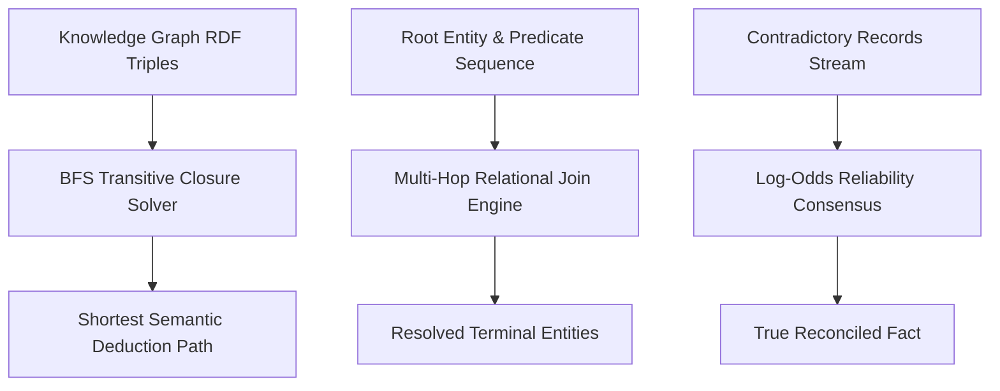

# genpark-wukong-enterprise-brain


GenPark Wukong Enterprise Brain is a zero-dependency knowledge graph traversal, multi-hop semantic relational deduction, and data consensus reconciliation engine for autonomous enterprise agents.



## Features
- **Knowledge Graph Pathfinding**: Discovers multi-hop transitive relation chains $(s, p, o)$ using Breadth-First Search without external graph databases.
- **Multi-Hop Semantic Query**: Evaluates sequential predicate pipelines across structured entity graphs.
- **Log-Odds Consensus Arbiter**: Resolves contradictory enterprise records by weighting sources according to statistical reliability scores.

## Quickstart

```python
from client import GenParkWukongEnterpriseBrain

brain = GenParkWukongEnterpriseBrain()
kg = [{"subject": "Alice", "predicate": "leads", "object": "Team"}]
res = brain.find_knowledge_graph_relation_path(kg, "Alice", "Team")
print("Connected:", res["connected"])
```

## License
MIT
