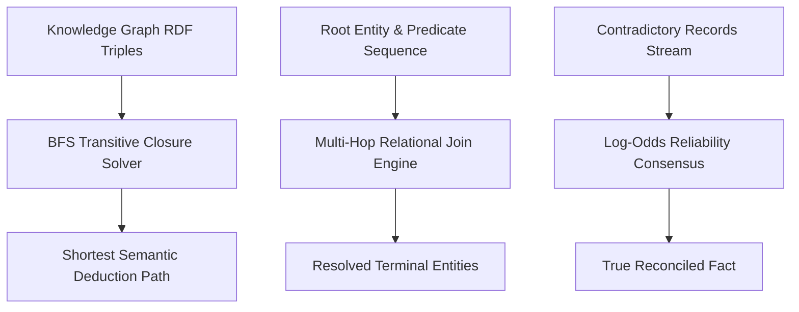

# genpark-wukong-enterprise-brain


GenPark Wukong Enterprise Brain has a standard-library core for knowledge graph traversal, multi-hop semantic relational deduction, and data consensus reconciliation engine for autonomous enterprise agents.



## MCP runtime requirements

Use Python 3.10 or newer. The core `client.py` uses only the standard library; `mcp_server.py` requires the official `mcp` SDK (`mcp>=1.0.0,<2`). From this repository's checkout, create an isolated environment and install its requirements:

```bash
python -m venv .venv
.venv/bin/python -m pip install -r requirements.txt
```

On Windows, use `.venv\Scripts\python.exe` instead. You may use an existing Python environment with the requirements installed. Configure your MCP client with that interpreter's absolute path and the absolute path to `mcp_server.py`. The client launches a local STDIO process; the GitHub repository URL is not a remote MCP endpoint.

Example client configuration (replace the placeholder paths):

```json
{
  "mcpServers": {
    "genpark-wukong-enterprise-brain": {
      "command": "/absolute/path/to/genpark-wukong-enterprise-brain/.venv/bin/python",
      "args": [
        "/absolute/path/to/genpark-wukong-enterprise-brain/mcp_server.py"
      ]
    }
  }
}
```

## Features
- **Knowledge Graph Pathfinding**: Discovers multi-hop transitive relation chains $(s, p, o)$ using Breadth-First Search without external graph databases.
- **Multi-Hop Semantic Query**: Evaluates sequential predicate pipelines across structured entity graphs.
- **Log-Odds Consensus Arbiter**: Resolves contradictory enterprise records by weighting sources according to statistical reliability scores.

## Quickstart

```python
from client import GenParkWukongEnterpriseBrain

brain = GenParkWukongEnterpriseBrain()
kg = [{"subject": "Alice", "predicate": "leads", "object": "Team"}]
res = brain.find_knowledge_graph_relation_path(kg, "Alice", "Team")
print("Connected:", res["connected"])
```

## License
MIT
